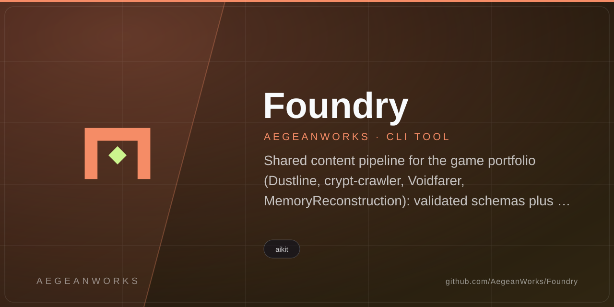

# foundry

<!-- aegean:media:start -->
<p align="center"></p>
<p align="center"><a href="LICENSE"></a> <a href="https://github.com/AegeanWorks/AIKit"></a></p>
<!-- aegean:media:end -->


Shared content pipeline for the game portfolio: validated schemas plus a
generator that emits per-game data packs, with the fairness validator as
gatekeeper. Slice 1 targets crypt-crawler bosses; the target registry now
also maps After Image, Aldervale, Shooter, Weft, Iris, Primordia, Cyberpulse
and Fold from their own authored content, read-only. It also emits
deterministic Keystone asset packs (meshes, textures, materials, prefabs)
and proves them through Keystone's own AssetRegistry. Generation stays
stdlib-only; the runtime proof loads Keystone when the sibling project is
present.

## Cold-Start Quick Reference

- **Runtime Prerequisites**: Python 3.10+ (Playwright + Edge only for `tools/bot_clear.py`; Keystone's pinned stack only for `tools/keystone_assets.py --verify`; everything else is stdlib).
- **Canonical Regression Shield Gate**:
  ```bash
  python -m unittest discover tests
  ```

```powershell
cd projects/foundry
python -m unittest discover tests            # full suite, must stay green
python generators/boss.py --seeds 42,777,1337 --out packs/crypt-crawler
python validators/boss.py "packs/crypt-crawler/*.json"
python ../crypt-crawler/tools/validate_fairness.py --seeds 42,777,1337 --depths 3
python tools/bot_clear.py packs/crypt-crawler/<boss>.json --report report.json
```

Target cockpit (read-only adapters over the consumer projects):

```powershell
python tools/targets.py                      # list every target and its surfaces
python generators/target.py --check          # manifests match the consumer sources
python validators/target.py "targets/*.json" # every manifest passes
python tools/portfolio_analysis.py --check   # every playable project is a target
```

Consumer side (crypt-crawler): install packs by copying the JSON files
into `projects/crypt-crawler/packs/` (data install, no code change), then
`python -m unittest discover tests` from `projects/crypt-crawler/`.

Every registered target also ships a generated manifest in `targets/`.
The new target adapters read authored tables statically (JSON, AST, JS
source); the pre-existing crypt-crawler adapter keeps its live
`ITEM_CATALOG` import. No target project is edited or written by foundry.

Keystone asset pack (deterministic meshes, textures, materials and prefab;
the verifier loads them through Keystone's real AssetRegistry):

```powershell
python generators/keystone_assets.py --seed 42 --out packs/keystone/starter
python generators/keystone_assets.py --check
python validators/keystone_assets.py
python tools/keystone_assets.py --verify
```

## What's Inside

```text
foundry/
├── README.md
├── .gitignore
├── COMMERCIAL.md
├── LICENSE
├── LICENSES/
├── REUSE.toml
├── assets/
├── .aikit/
│   ├── codebase_map.md
│   ├── decisions.md
│   ├── guidelines.md
│   ├── media.json
│   ├── project.json
│   └── task_ledger.json
├── adapters/
│   ├── __init__.py
│   ├── base.py
│   ├── layout.py
│   ├── registry.py
│   ├── source_js.py
│   ├── source_py.py
│   ├── crypt_crawler.py
│   ├── keystone.py
│   ├── afterimage.py
│   ├── aldervale.py
│   ├── shooter.py
│   ├── weft.py
│   ├── iris.py
│   ├── primordia.py
│   ├── cyberpulse.py
│   ├── fold.py
│   ├── dustline.py
│   ├── memoryreconstruction.py
│   ├── prism_relay.py
│   └── voidfarer.py
├── generators/
│   ├── __init__.py
│   ├── boss.py
│   ├── keystone_assets.py
│   └── target.py
├── schemas/
│   ├── boss.schema.json
│   ├── keystone_assets.schema.json
│   └── target.schema.json
├── targets/
│   ├── crypt-crawler.json
│   ├── keystone.json
│   ├── afterimage.json
│   ├── aldervale.json
│   ├── shooter.json
│   ├── weft.json
│   ├── iris.json
│   ├── primordia.json
│   ├── cyberpulse.json
│   ├── fold.json
│   ├── dustline.json
│   ├── memoryreconstruction.json
│   ├── prism-relay.json
│   └── voidfarer.json
├── tests/
│   ├── test_generator.py
│   ├── test_keystone_assets.py
│   ├── test_portfolio_analysis.py
│   ├── test_targets.py
│   └── test_validator.py
├── tools/
│   ├── bot_clear.py
│   ├── keystone_assets.py
│   ├── portfolio_analysis.py
│   └── targets.py
├── validators/
│   ├── __init__.py
│   ├── boss.py
│   ├── keystone_assets.py
│   └── target.py
└── packs/
    ├── crypt-crawler/
    │   ├── boss_ashen_warden_s42.json
    │   ├── boss_pale_warden_s1337.json
    │   └── boss_ruin_vesper_s777.json
    └── keystone/
        └── starter/
            ├── keystone-assets.json
            ├── meshes/
            │   ├── mesh_cube.obj
            │   ├── mesh_crystal.obj
            │   └── mesh_plane.obj
            ├── prefabs/
            │   └── prefab_starter.kprefab
            └── textures/
                ├── texture_checker.png
                └── texture_gradient.png
```

- `schemas/boss.schema.json` — canonical boss format (slice-1 envelope).
- `schemas/target.schema.json` — canonical target manifest.
- `schemas/keystone_assets.schema.json` — canonical Keystone asset pack.
- `validators/boss.py` — gatekeeper: every pack validates, failures name
  `field: reason`.
- `validators/target.py` — target gate: registered id, safe project/source
  paths, non-empty unique content surfaces.
- `validators/keystone_assets.py` — Keystone pack gate: manifest shape,
  file digests, dependency order and prefab references.
- `generators/boss.py` — seeded, deterministic, valid-by-construction.
- `generators/target.py` — canonical target manifests, byte-identical on
  regeneration.
- `generators/keystone_assets.py` — seeded OBJ/PNG/KPREFAB pack generator.
- `adapters/registry.py` — every consumer foundry can target.
- `adapters/keystone.py` — Keystone asset kinds, suffixes, primitives and
  material-graph node kinds.
- `adapters/crypt_crawler.py` — consumer facts (catalog ids, target, pack
  major). The reverse mapping lives game-side in
  `crawler/foundry_packs.py`; the pair is the versioned adapter.
- `adapters/<game>.py` — read-only facts for the other targets; source
  readers parse JSON, Python AST or JavaScript without importing the game.
- `packs/crypt-crawler/` — baselined generated packs (seed set 42/777/1337).
- `packs/keystone/starter/` — baselined Keystone assets (seed 42).
- `targets/` — checked-in manifests for every registered target.
- `tools/bot_clear.py` — bot-clear proof against the shipped engine.
- `tools/keystone_assets.py` — validate and load a pack through Keystone.
- `tools/portfolio_analysis.py` — classify every project and check target coverage.
- `tools/targets.py` — list targets, write manifests, verify freshness.
- `.aikit/decisions.md` — ADRs, append-only.

## Registered Targets

| Target | Project | Lifecycle | Authored surfaces |
|---|---|---|---|
| crypt-crawler | `projects/crypt-crawler` | active | items |
| keystone | `projects/keystone` | active | asset kinds, file suffixes, primitives, material nodes |
| afterimage | `projects/afterimage` | active | modes, scripts |
| aldervale | `projects/archive/aldervale` | archived | items, shop stock, weapons, armor |
| shooter | `projects/shooter` | active | enemies, weapons, waves, arena covers |
| weft | `projects/weft` | active | chambers, sizes |
| iris | `projects/archive/iris` | archived | episodes, chambers |
| primordia | `projects/primordia` | active | genes, shocks, hunter traits |
| cyberpulse | `projects/cyberpulse` | active | puzzle types, story acts, main quests |
| fold | `projects/archive/fold` | archived | directions, rules |
| dustline | `projects/dustline` | active | maps, weapons, enemies, bosses, mega bosses, operators, modes, mutators |
| memoryreconstruction | `projects/MemoryReconstruction` | active | player/enemy abilities, biomes, enemies, equipment, items, lore, memory fragments |
| prism-relay | `projects/prism-relay` | active | episodes, chambers, emitter directions |
| voidfarer | `projects/voidfarer` | active | weapons, enemies, factions, drones, systems, surface types |

Archived targets stay readable and are never edited; foundry only parses
their files.

## Portfolio Analysis

Every playable project in `projects/` is now a target: thirteen games plus
the Keystone engine. The remaining projects fall into non-target groups
because they do not consume authored game content:

| Group | Examples | Why not a target |
|---|---|---|
| Tooling / developer utilities | `assay`, `cairn`, `driftwood`, `dupefinder`, `gauge`, `lacon`, `merklock`, `pebble`, `research-engine`, `tally` | CLI/library tools with no game-content surface |
| AI / agent platforms | `Atlas`, `chatduck`, `modelduck`, `neurocore` | applications over models/documents, not content consumers |
| Science / research | `article-writer`, `fluid-universe`, `obezite-mekanizma-projesi`, `orrery`, `PNN` | simulations and papers, not shipped game assets |
| Desktop / mobile / health | `NeuralBeat`, `NeuralDeck`, `NeuroOptic`, `NobetWizard`, `noesis`, `nomoreclutter`, `photo-harbor` | end-user apps whose content is user data or generated media |
| Creative / design tools | `muse`, `palette`, `tessera`, `ui-sandbox` | authoring tools, not consumers of Foundry packs |
| Licensing / profile / samples | `aegean-licensing`, `aegean-licensing-ops`, `AegeanWorks`, `capability-showcase`, `compat-sample-*`, `lattice`, `N1-Engine`, `NeurologyClinicTemplates-TR`, `tempo` | infrastructure, documentation or samples |

The analysis rule is simple: a target must read authored content from its
own project and expose stable assets/ids; otherwise it is out of scope until
it gains such a surface.

## Gates (never lowered)

1. Suite green (`python -m unittest discover tests`).
2. Every pack validates before it ships; invalid packs fail with field+reason.
3. Fairness: no unwinnable seed, telegraphed patterns, economy in bounds —
   proven by bot runs (ai_harness Playwright; Keystone once it lands).
4. Every target manifest is fresh and valid
   (`python generators/target.py --check`,
   `python validators/target.py "targets/*.json"`); target projects stay
   unmodified.
5. Every Keystone asset pack is fresh and valid
   (`python generators/keystone_assets.py --check`,
   `python validators/keystone_assets.py`), and the runtime proof loads it
   (`python tools/keystone_assets.py --verify`).
6. Portfolio coverage is complete: every project classified as a game or
   engine has a target (`python tools/portfolio_analysis.py --check`).

<!-- aegean:brand-assets:start -->
## 🎨 Brand Assets

> **AI-Generated Brand Artwork.** The banner and logo are **AI-generated brand assets**. They are illustrative and may not literally depict every feature or the full project scope.
<!-- aegean:brand-assets:end -->

## 📜 License

<!-- aegean:license:start -->
Free for personal use under the Aegean License 1.1 (AL-1.1); see [LICENSE](LICENSE). Any commercial use needs the Aegean Commercial License 1.0 (ACL-1.0); see [COMMERCIAL.md](COMMERCIAL.md).
<!-- aegean:license:end -->
